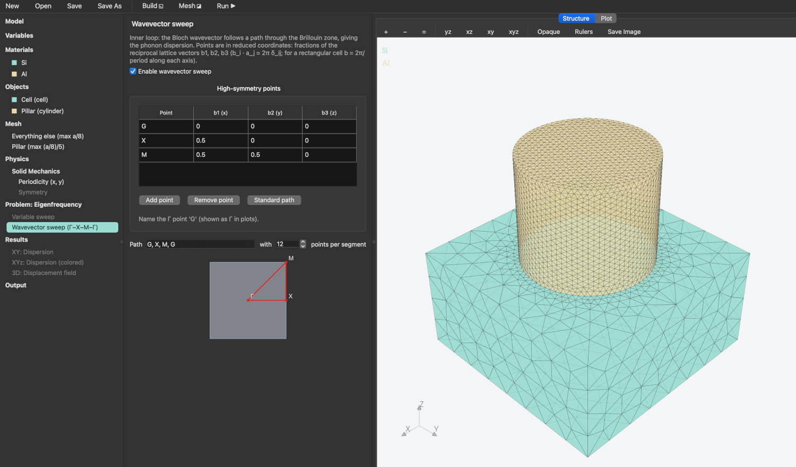

# Home

<div align="left"></div>

**SolidOcean** is a free and open-source finite element modelling tool for calculating and analysing phonon dispersion relations, mechanical waves, and heat transfer problems.

Essentially, it is a Qt user interface that unites several open-source tools for creating a mesh (with Gmsh mesher), solving differential equations with boundary conditions (with MUMPS solver), and analyzing the results (with Matplotlib). Every model is a simple human-readable TOML file that can also be run headless from the command line, making it ideal for scripting and working with agents.

<figure><figcaption><p>A silicon unit cell with an aluminium pillar: its mesh, and the wavevector sweep of its phonon dispersion</p></figcaption></figure>

## What it can do

**Solid mechanics problems**

* **Eigenfrequencies** and mode shapes calculations with phonon dispersion along chosen wavevector paths in selected Brillouin zones.
* **Stationary** displacement calculation with strain, stress and von Mises stress under fixed or prescribed displacements and boundary loads.
* **Frequency domain** problems with the driven response to oscillating loads or displacements, with loss factors and absorbing regions.

**Heat transfer problems**

* **Stationary** and **transient** problems with fixed temperature, heat flux, convection and radiation boundaries, volume heat sources with pulses and spatial profiles, thermal boundary resistances and thin resistive layers at interfaces.
* **Frequency domain** problems with the temperature oscillation driven at one frequency, as in the 3ω and FDTR methods.

## Two ways to work



Ideal for designing the model. The `New`  button offers templates of the models. Launch as:

```bash
solidocean
```



Ideal for scripting. A run writes its tables, data and a copy of the model into a folder named after the parameters of the run, so reruns do not overwrite each other.

```bash
solidocean model_name.toml                      # run it headless
solidocean --set "r=0.35*a" model_name.toml     # change a variable
```



## Where to go next

* [Installation](installation.md) — ways to install the software.
* [Usage](usage.md) — the command line, the interface, templates, sweeps, and what a run writes.
* [Model file](model-file.md) — every section and key of the model file.
* [Tutorials](tutorials/) — a few example models.
* [Formalism](physics/) — the formulation, the elements and the solvers.
* [Validation](validation/) — comparisons with exact solutions, and the full report.
* [Licenses](licenses.md) — SolidOcean's license and those of the projects it builds on.

## Source code

The source lives at [github.com/anufrievroman/solidocean](https://github.com/anufrievroman/solidocean). How the code is organised, and how to add to it, is described under [Technical documentation](technical/architecture.md).

## Disclaimer

SolidOcean is an independent project. It is a graphical interface to open-source tools that already exist, uniting their workflow under one roof as a lab tool for academic research. It is provided as is, without any warranty. Check the results of your models against known solutions before relying on them.
