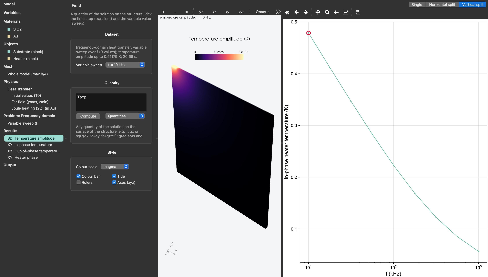

# 3ω experiment

The frequency-domain problem solves for the complex amplitude of a temperature oscillating at one frequency, the observable of 3ω and FDTR experiments, instead of stepping through time. This template is a gold heater line (width 2b = 2 µm) on fused silica, dissipating a power per length `P` that oscillates at the driving frequency, swept over two decades.


```toml
[variables]
b = "1[um]"
h = "100[nm]"
D = "20[um]"
Lx = "0.5[um]"
P = "1[W/m]"
T0 = "300[K]"
f = "10[kHz]"

[problem.sweep]
variable = "f"
values = "logspace(4, 6, 9) * 1[Hz]"

[heat]
initial = "T0"
sources = [
    { name = "Joule heating (2ω)", material = "Au", value = "P / (2*b*h)" },
]

[[heat.conditions]]
type = "temperature"
name = "Far field"
faces = ["ymax", "zmin"]
value = "T0"

[heat.problem]
type = "frequency"
frequency = "f"

[[plots]]
name = "In-phase temperature"
kind = "quantity"
quantity = "mean(Tre, \"Heater\")"
[plots.style]
x_log = true
```


The model is a thin slice of the line with its cut faces insulated, which makes the line infinitely long, and half of the line by symmetry (an insulated face is a mirror plane for heat). The far faces are held at the ambient temperature, more than five thermal penetration depths √(α/ω) away at the lowest frequency.

<figure><figcaption><p>Temperature amplitude at 10 kHz around the heater and the in-phase heater temperature over the frequency sweep</p></figcaption></figure>

Four fields are available for a frequency-domain solution: `Tamp` and `Tphase` (amplitude and phase, the phase in degrees and negative when the temperature lags the drive), and `Tre` and `Tim` (the in-phase and out-of-phase parts). Reductions work on them as usual, so `mean(Tre, "Heater")` is the in-phase average over the gold line, exactly what a 3ω measurement reads.

**Run it and fit the slope.**

```
f,time [s],"mean(Tre, ""Heater"")","mean(Tim, ""Heater"")","atan2(…) * 180/pi"
10000,0,0.4789555434,-0.1779498564,-20.38191019
17782.7941,0,0.4124598821,-0.1748491741,-22.97296274
31622.7766,0,0.3468658164,-0.1692868192,-26.01455057
...
1000000,0,0.05667945282,-0.07132742076,-51.52802446
```

The in-phase part falls linearly with ln f, with slope −P/(2πk), while the out-of-phase part stays near −P/(4k): that is the 3ω slope method for the substrate's conductivity. Fitting the three lowest frequencies above gives k = 1.387 W/(m·K) against the 1.38 W/(m·K) put into the model, and the out-of-phase part, −0.178 K, is close to −P/(4k) = −0.181 K.

**Things to try.**

* Add a thermal boundary resistance between the line and the substrate, `[[heat.interfaces]]` with `between = ["Heater", "Substrate"]` and an `R`, and watch the phase shift.
* Change the substrate's `k` and refit: this is the measurement itself, in reverse.
* Open the `heat_fdtr` template for the other frequency-domain method, a modulated Gaussian pump spot on a gold transducer film, read out through its temperature amplitude and phase.
