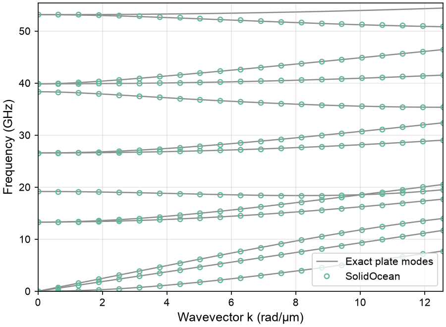

# Phonon dispersion

The guided waves of a free-standing 220 nm silicon membrane. An infinite plate is modelled as **one small unit cell**: the periodicity is declared in `[lattice]`, and the eigenfrequencies are solved along a path of wavevectors. The template is `membrane`.

<figure><figcaption><p>Unit cell of the membrane with periodicity in x and y, and the dispersion branches along the wavevector sweep</p></figcaption></figure>


```toml
[variables]
t = "220[nm]"
a = "50[nm]"

[[objects]]
type = "block"           # one cell of the membrane: a × a in-plane, t thick
name = "Membrane"
material = "Si"
center = ["0", "0", "0"]
size = ["a", "a", "t"]

[lattice]
x = "a"
y = "a"

[mesh]
max_size = "a/2"

[solid.problem]
type = "eigenfrequency"

[solid.problem.kpath]
path = ["G", "K"]
n = 20

[solid.problem.kpath.points]
G = [0, 0, 0]
K = [0.1, 0, 0]
```


The faces that map onto each other across the lattice vectors become **Bloch-periodic**: on each one, u(x + R) = exp(ik·R) u(x). Repeated in x and y, the cell is an infinite plate, and the top and bottom faces are free, so the plate is suspended.

The period `a` is an auxiliary length, not a feature of the membrane. It only has to be short enough that no folded band falls into the range of interest: bands folded from the neighbouring zones start near the sound velocity divided by `a`, around 100 GHz here, far above the 55 GHz computed. The k-path points are reduced coordinates, fractions of the reciprocal lattice vector, so `K = [0.1, 0, 0]` is 0.1 × 2π/a = 12.6 rad/µm along x, the [100] direction of the crystal.

**Run it.** The matrices are assembled once and only the periodicity changes from one wavevector to the next, so 21 solves take about two seconds:

```bash
$ solidocean membrane.toml
SolidOcean 0.2.0: Membrane (plate) -> membrane
Meshing…
Mesh: 420 elements, 921 nodes (2763 DOFs), order 2 [0.0 s]
Assembly: 1848 free DOFs [0.0 s]
...
[21/21]
  lowest: 0, 1.267e-07, 6.694e-07, 13.29, 13.29, 19.17 GHz
Done in 1.87 s
```

The three vanishing frequencies at Γ are where the three acoustic branches of a plate start: the flexural wave A0, quadratic in k, and the in-plane waves SH0 and S0, linear in k. The next frequencies are the thickness resonances: 13.29 GHz, twice, is the shear resonance √(C44/ρ) / 2t, and 19.17 GHz the longitudinal one √(C11/ρ) / 2t.

`dispersion.csv` has one row per solve: the wavevector, the distance along the path, and the eigenfrequencies.

```
kx [rad/m],ky [rad/m],kz [rad/m],k path [rad/m],f1 [GHz],f2 [GHz],…
0,0,0,0,0,1.266877425e-07,6.69394573e-07,13.28689131,…
628318.5307,0,0,628318.5307,0.03098144317,0.5846174706,0.7781482082,…
```

**Comparison with the exact plate modes.** The guided waves of a free plate are known exactly: the Lamb waves, with the displacement in the plane of propagation, and the shear-horizontal waves, polarised across it. Silicon is cubic rather than isotropic, so the classical Rayleigh-Lamb equations do not apply as they are. For waves along [100] in a (001) plate, the exact modes follow from the same partial-wave conditions with C11, C12 and C44 [1, 2], solved here to machine precision through the thickness. Every computed eigenfrequency lies on an exact branch, with a median error of 0.02 % and at most 0.19 %:

<figure><figcaption><p>Exact guided modes of the plate (lines) and the eigenfrequencies of the template (circles). The line rising above 53 GHz is the 13th mode, above the 12 the template computes.</p></figcaption></figure>

The [validation report](../validation/report.md) makes the same comparison for an isotropic plate, against the Rayleigh-Lamb equations, with the convergence of the error as the mesh is refined.

**In the interface**, the dispersion plot shows the branches with the Γ and K ticks; clicking a point shows and animates that mode shape. The template's second plot colours every point by

```toml
color_by = "mean(abs(uz)^2)"
```

the out-of-plane fraction of the mode. Mode shapes are normalised so that `mean(abs(ux)^2+abs(uy)^2+abs(uz)^2) = 1`, so that number lies between 0 and 1, and it separates the flexural branches from the in-plane ones at a glance.

**Things to try.**

* Make the membrane thinner or thicker with `t`: the thickness resonances move as 1/t, while the slopes of the in-plane branches at Γ stay the same.
* Rotate the crystal with `rotation_deg = ["0", "0", "45"]` on the material to send the waves along [110] instead; the in-plane velocities change, because silicon is anisotropic.
* Perforate the membrane: the `square` template adds a lattice of holes to the cell, and the period becomes a real length of the structure, with band gaps between the branches.

**References**

\[1] B. A. Auld, *Acoustic Fields and Waves in Solids*, Vol. II, 2nd ed. (Krieger, 1990).

\[2] J. L. Rose, *Ultrasonic Guided Waves in Solid Media* (Cambridge University Press, 2014).
