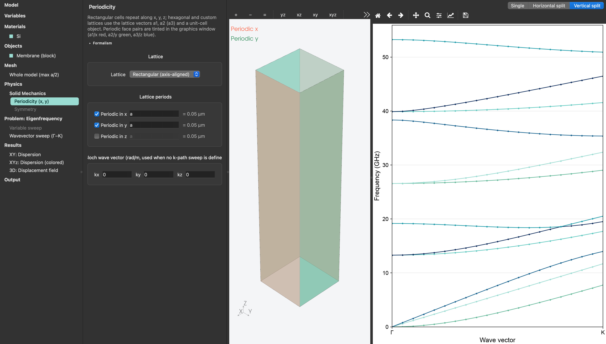

# Phonon dispersion

A square lattice of holes in a 200 nm silicon membrane: the model is **one unit cell**, the periodicity is declared in `[lattice]`, and the eigenfrequencies are solved along a path through the Brillouin zone.

<figure><figcaption><p>Unit cell with periodicity in x and y, and the dispersion branches along the wavevector sweep</p></figcaption></figure>


```toml
[variables]
a = "400[nm]"
t = "200[nm]"
r = "0.43*a"

[[objects]]
type = "cell"            # the unit cell of the lattice, extruded to height t
name = "Cell"
material = "Si"
center = ["0", "0", "0"]
height = "t"

[[objects]]
type = "cylinder"        # the hole
name = "Hole"
op = "subtract"
center = ["0", "0", "-t/2"]
axis = ["0", "0", "1"]
radius = "r"
height = "t"

[lattice]
x = "a"
y = "a"

[mesh]
max_size = "a/8"
min_size = "a/40"

[solid.problem]
type = "eigenfrequency"
num_eigs = 16

[solid.problem.kpath]
path = ["G", "X", "M", "G"]
n = 12

[solid.problem.kpath.points]
G = [0, 0, 0]
X = [0.5, 0, 0]
M = [0.5, 0.5, 0]
```


The faces that map onto each other across the lattice vectors become **Bloch-periodic**: on each one, u(x + R) = exp(ik·R) u(x). The top and bottom faces are free, so the structure is a suspended membrane. The k-path points are reduced coordinates, fractions of the reciprocal lattice vectors, so `X = [0.5, 0, 0]` is the edge of the zone along x whatever `a` is.

**Run it.** The matrices are assembled once and only the periodicity changes from one wavevector to the next, so 37 solves of a 6483-DOF model take seconds:

```bash
$ solidocean square.toml
SolidOcean 0.1.0: Square-lattice hole-based phononic crystal -> square
Meshing…
Mesh: 1014 elements, 2161 nodes (6483 DOFs), order 2 [0.0 s]
Assembly: 5328 free DOFs [0.1 s]
...
[37/37]
  lowest: 0, 2.404e-07, 4.066e-07, 6.822, 7.137, 7.139 GHz
Done in 15.02 s
```

The three vanishing frequencies at Γ are the rigid-body translations of the cell, the acoustic branches starting from zero, a useful sanity check that the periodicity is being applied.

`dispersion.csv` has one row per solve: the wavevector, the distance along the path, and the eigenfrequencies.

```
kx [rad/m],ky [rad/m],kz [rad/m],k path [rad/m],f1 [GHz],f2 [GHz],…
0,0,0,0,0,2.404472254e-07,4.06646696e-07,6.821628602,…
654498.4695,0,0,654498.4695,0.02249432819,0.1810153659,0.5935865245,…
```

**In the interface**, the dispersion plot shows the branches with Γ, X, M ticks; clicking a point shows and animates that mode shape. The template's second plot colours every point by

```toml
color_by = "mean(abs(uz)^2)"
```

the out-of-plane fraction of the mode, because mode shapes are normalized, so that `mean(abs(ux)^2+abs(uy)^2+abs(uz)^2) = 1`, that number is between 0 and 1 and separates the flexural branches from the in-plane ones at a glance.

**Things to try.**

* Sweep the hole radius, `[problem.sweep]` with `variable = "r"`, and watch the band gap open and close.
* Switch the lattice: the `hexagonal` and `honeycomb` templates use `vectors` instead of axis periods, with the matching k-path (`M`, `K`).
* Add a pillar on top of the cell (the `pillars` template) for local resonances inside the bands.
