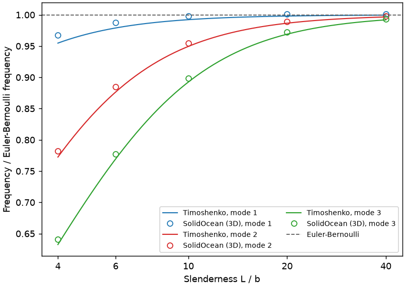
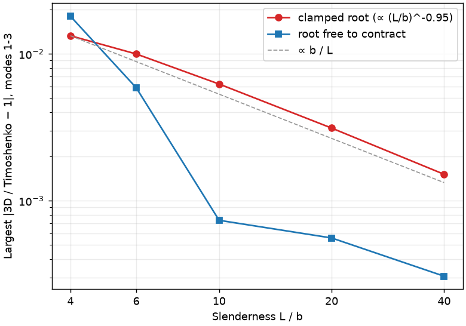
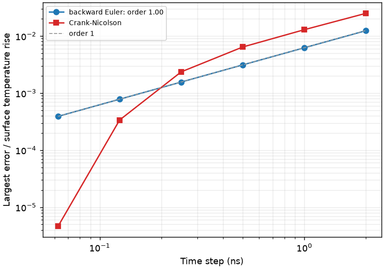
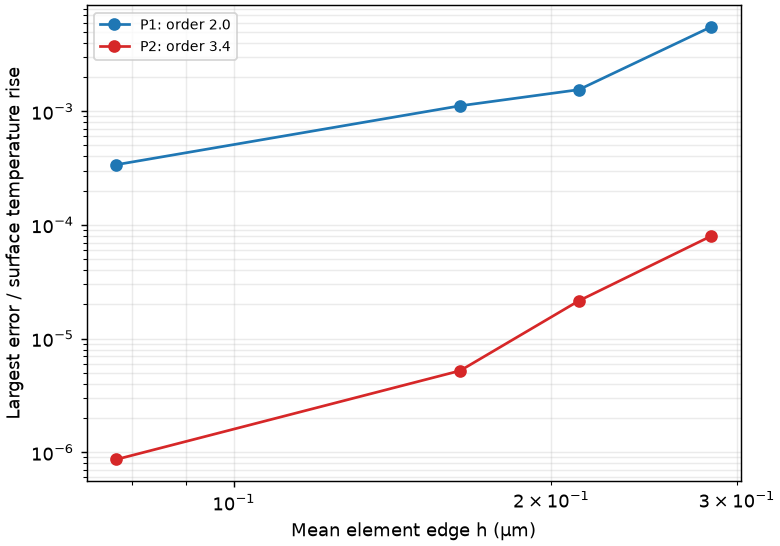
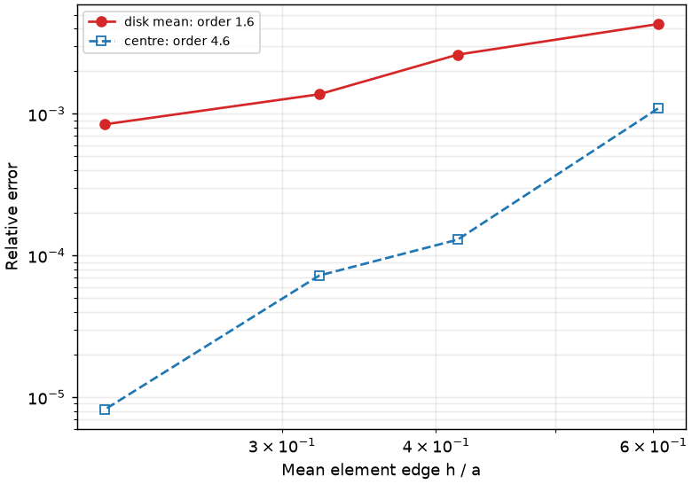

# Full report

SolidOcean is checked against exact solutions of elasticity and heat conduction. Every case builds ordinary models (written to `validation/models/`, they open in the GUI) and solves them with the same solvers as the command line; most also refine the mesh or the time step to show that the error falls at the rate theory predicts for the elements (for quadratic elements: eigenfrequencies $$h^4$$, displacements and temperatures $$h^3$$, stresses and fluxes $$h^2$$). Element sizes $$h$$ are measured mean edge lengths of the meshes.

This page is generated by `python validation/run.py` in the source repository (about three minutes); see [Testing and validation](../technical/testing.md).

| case | result | checks | run time |
|---|---|---:|---:|
| [Lamb waves in a free plate](#lamb-waves-in-a-free-plate) | ✅ passed | 3/3 | 36 s |
| [Free vibrations of an elastic sphere](#free-vibrations-of-an-elastic-sphere) | ✅ passed | 3/3 | 22 s |
| [Cantilever bending modes](#cantilever-bending-modes) | ✅ passed | 3/3 | 11 s |
| [Driven bar: resonances with losses](#driven-bar-resonances-with-losses) | ✅ passed | 1/1 | 7 s |
| [Thick-walled cylinder under internal pressure](#thick-walled-cylinder-under-internal-pressure) | ✅ passed | 5/5 | 5 s |
| [Semi-infinite solid heated by a surface flux](#semi-infinite-solid-heated-by-a-surface-flux) | ✅ passed | 4/4 | 21 s |
| [Disk heater on a half-space: spreading resistance](#disk-heater-on-a-half-space-spreading-resistance) | ✅ passed | 3/3 | 13 s |
| [Thermal boundary resistance in a layer stack](#thermal-boundary-resistance-in-a-layer-stack) | ✅ passed | 2/2 | 2 s |
| [3ω heater line: frequency-domain heat transfer](#3ω-heater-line-frequency-domain-heat-transfer) | ✅ passed | 2/2 | 12 s |
| [FDTR: transducer film, boundary conductance and substrate](#fdtr-transducer-film-boundary-conductance-and-substrate) | ✅ passed | 2/2 | 37 s |

## Elastic waves and vibrations

### Lamb waves in a free plate

A free isotropic plate (thickness $$t$$, $$\nu = 0.3$$), periodic in-plane, with the Bloch wave vector $$k$$ along $$x$$: all guided modes of a plate. Reference: the exact Rayleigh-Lamb equations for the symmetric and antisymmetric Lamb modes,

$$
\frac{\tan(q t/2)}{\tan(p t/2)} = -\left[\frac{4k^2pq}{(q^2-k^2)^2}\right]^{\pm 1},\qquad p^2 = \frac{\omega^2}{c_L^2} - k^2,\quad q^2 = \frac{\omega^2}{c_T^2} - k^2,
$$

and the shear-horizontal modes $$\omega^2 = c_T^2\,(k^2 + (n\pi/t)^2)$$, solved to machine precision. The cell ($$t/4 \times t/4$$ in-plane) is small enough that no folded band falls below the compared range ($$\Omega = \omega t / c_T < 12$$, $$kt \le 6$$): every computed eigenfrequency must be one of the exact ones. Quadratic elements; the convergence study refines the mesh at $$kt = 3$$.

*Mesh convergence at kt = 3: all modes with ω t / c_T < 12.*

| elements | h / t | DOFs | modes | median error | max error |
|---|---:|---:|---:|---:|---:|
| P1 | 0.0980 | 396 | 10 | 1.15e-02 | 4.99e-02 |
| P1 | 0.0771 | 786 | 10 | 7.03e-03 | 2.53e-02 |
| P1 | 0.0526 | 2334 | 10 | 3.38e-03 | 1.33e-02 |
| P1 | 0.0405 | 5085 | 10 | 2.07e-03 | 7.74e-03 |
| P2 | 0.0980 | 3024 | 10 | 3.84e-05 | 6.52e-04 |
| P2 | 0.0771 | 6063 | 10 | 1.20e-05 | 1.44e-04 |
| P2 | 0.0526 | 18507 | 10 | 2.46e-06 | 3.51e-05 |
| P2 | 0.0405 | 40839 | 10 | 8.59e-07 | 1.24e-05 |

<figure><figcaption>
Guided modes of a free plate: exact Rayleigh-Lamb and SH branches (dots) and the computed eigenfrequencies (circles), mesh h = t/16.
</figcaption></figure>

<figure><figcaption>
Mesh convergence of the eigenfrequencies at kt = 3 (largest error of all modes below ω t / c_T = 12); expected orders 2h (P1: 2, P2: 4).
</figcaption></figure>

**Checks:** ✅ largest frequency error along the path (h = t/16): 2.74e-04 (≤ 1.00e-03); ✅ P2 convergence order: 4.35 (≥ 3.50); ✅ P1 convergence order: 2.04 (≥ 1.80). Run time 36 s.

### Free vibrations of an elastic sphere

A free isotropic sphere (radius $$a$$, $$\nu = 0.25$$), meshed with curved quadratic elements. Reference: Lamb's exact solution. Torsional modes $${}_nT_l$$ satisfy $$x\,j_l'(x) = j_l(x)$$ with $$x = \omega a / c_T$$; spheroidal modes $${}_nS_l$$ follow from the traction-free surface ($$\sigma_{rr} = \sigma_{r\theta} = 0$$) for the displacement $$\mathbf{u} = \nabla\varphi + \nabla\times\nabla\times(\mathbf{r}\,\psi)$$ with $$\varphi = A\,j_l(\omega r/c_L)\,Y_{lm}$$, $$\psi = B\,j_l(\omega r / c_T)\,Y_{lm}$$ (a 2×2 determinant, solved to machine precision; the breathing mode is checked against Lamb's closed form $$\xi\cot\xi = 1 - \xi^2 c_L^2 / (4c_T^2)$$). Each mode of angular order $$l$$ is $$(2l+1)$$-fold degenerate. All computed eigenfrequencies up to $$\omega a / c_T = 4.6$$ (the six rigid-body modes removed) are compared with the exact spectrum, multiplicities included.

*Mode multiplets below ω a / c_T = 4.6 (mesh a/10): T torsional, S spheroidal, index l.*

| mode | multiplicity | exact ω a/c_T | computed (mean) | max error |
|---|---:|---:|---:|---:|
| T2 | 5 | 2.501133 | 2.501156 | 9.4e-06 |
| S2 | 5 | 2.639869 | 2.639887 | 6.8e-06 |
| S1 | 3 | 3.424530 | 3.424593 | 1.9e-05 |
| T3 | 7 | 3.864700 | 3.864852 | 4.0e-05 |
| S3 | 7 | 3.916337 | 3.916542 | 5.3e-05 |
| S0 | 1 | 4.439998 | 4.440007 | 2.1e-06 |

*Mesh convergence (quadratic elements, all modes below the limit).*

| h / a | DOFs | median error | max error |
|---|---:|---:|---:|
| 0.256 | 13116 | 4.45e-04 | 8.65e-04 |
| 0.216 | 21135 | 2.25e-04 | 4.17e-04 |
| 0.161 | 49152 | 6.93e-05 | 1.29e-04 |
| 0.130 | 89826 | 2.86e-05 | 5.32e-05 |

<figure><figcaption>
Spectrum of the free sphere: exact multiplets and the computed eigenfrequencies, mesh a/10.
</figcaption></figure>

<figure><figcaption>
Mesh convergence of the sphere's eigenfrequencies (curved quadratic elements; expected order 4).
</figcaption></figure>

**Checks:** ✅ breathing mode: determinant vs closed form: 1.19e-13 (≤ 1.00e-12); ✅ largest frequency error (h = a/10): 5.32e-05 (≤ 1.00e-03); ✅ convergence order: 4.10 (≥ 3.30). Run time 22 s.

### Cantilever bending modes

A beam of square cross-section $$b \times b$$ and length $$L$$, clamped at one end ($$\nu = 0.3$$). Beam theories are exact only for slender beams, so the beam is computed for slenderness $$L/b$$ from 4 to 40 and compared with **Euler-Bernoulli** theory, $$\omega_n = (\beta_n L)^2 \sqrt{EI/(\rho A L^4)}$$ with $$1 + \cos\beta L \cosh\beta L = 0$$ ($$\beta_n L$$ = 1.8751, 4.6941, 7.8548), and **Timoshenko** theory (shear deformation and rotary inertia, Cowper's shear coefficient $$\kappa = 10(1+\nu)/(12+11\nu)$$), whose clamped-free frequencies are solved exactly with the transfer matrix of its ODEs. The 3D solution must tend to both as $$b/L \to 0$$, and follow Timoshenko's correction $$\propto (b/L)^2$$ for stubby beams. The bending modes come in degenerate pairs (bending in $$y$$ and $$z$$); they are told apart from torsional and axial modes by their mean displacement.

A fully clamped face also stops the Poisson contraction at the root, which beam theory ignores: this Saint-Venant end effect stiffens the 3D beam by a fraction $$\propto b/L$$. A root that may contract (symmetry plane $$u_x = 0$$, with $$u_y = u_z = 0$$ held only on a central patch) is much closer to the beam theories' clamp.

*Bending frequencies relative to Euler-Bernoulli, and the difference of the 3D beam from Timoshenko with a fully clamped root and with a root free to contract (mesh b/3, quadratic elements).*

| L/b | mode | 3D / EB | Timoshenko / EB | 3D vs Timoshenko | free root vs Timoshenko |
|---|---:|---:|---:|---:|---:|
| 4 | 1 | 0.96739 | 0.95477 | +1.32e-02 | +8.41e-04 |
| 4 | 2 | 0.78201 | 0.77251 | +1.23e-02 | -8.84e-03 |
| 4 | 3 | 0.64092 | 0.63252 | +1.33e-02 | -1.80e-02 |
| 6 | 1 | 0.98798 | 0.97897 | +9.20e-03 | +1.07e-03 |
| 6 | 2 | 0.88458 | 0.87653 | +9.18e-03 | -1.92e-03 |
| 6 | 3 | 0.77719 | 0.76951 | +9.99e-03 | -5.88e-03 |
| 10 | 1 | 0.99772 | 0.99225 | +5.52e-03 | +7.35e-04 |
| 10 | 2 | 0.95491 | 0.94952 | +5.68e-03 | +3.12e-04 |
| 10 | 3 | 0.89815 | 0.89259 | +6.23e-03 | -4.16e-04 |
| 20 | 1 | 1.00087 | 0.99804 | +2.83e-03 | +4.41e-04 |
| 20 | 2 | 0.98945 | 0.98658 | +2.91e-03 | +4.82e-04 |
| 20 | 3 | 0.97207 | 0.96904 | +3.12e-03 | +5.58e-04 |
| 40 | 1 | 1.00093 | 0.99951 | +1.42e-03 | +2.21e-04 |
| 40 | 2 | 0.99803 | 0.99659 | +1.45e-03 | +2.51e-04 |
| 40 | 3 | 0.99344 | 0.99194 | +1.51e-03 | +3.06e-04 |

*Mesh convergence at L/b = 10: change of the bending frequencies against the mesh b/6.*

| h | DOFs | mode 1 | mode 2 | mode 3 |
|---|---:|---:|---:|---:|
| b/2 | 2886 | 1.4e-03 | 2.6e-03 | 4.2e-03 |
| b/3 | 10383 | 6.8e-04 | 8.2e-04 | 1.0e-03 |
| b/4 | 19461 | 3.6e-04 | 4.1e-04 | 4.7e-04 |

<figure><figcaption>
Bending frequencies of the 3D cantilever divided by Euler-Bernoulli's, against slenderness, with Timoshenko's.
</figcaption></figure>

<figure><figcaption>
Difference between the 3D beam and Timoshenko theory: it vanishes like b/L, and is much smaller when the root may contract.
</figcaption></figure>

**Checks:** ✅ L/b = 40: 3D vs Timoshenko, modes 1-3: 1.51e-03 (≤ 2.00e-03); ✅ decay of the difference from Timoshenko, order in b/L: 0.95 (≥ 0.85); ✅ L/b = 40, root free to contract: 3D vs Timoshenko: 3.06e-04 (≤ 5.00e-04). Run time 11 s.

### Driven bar: resonances with losses

A bar of length $$L$$ in uniaxial strain (its side faces are symmetry planes, so compressional waves travel at $$c_L = \sqrt{C_{11}/\rho}$$ without dispersion), clamped at $$x = 0$$ and driven by a force amplitude $$F$$ on its end $$x = L$$, with a loss factor $$\eta$$ (complex stiffness $$C(1 + i\eta)$$). Reference: the exact harmonic response
$$
u(L) = \frac{F\,\tan(kL)}{C_{11}(1+i\eta)\,A\,k},\qquad k = \frac{\omega}{c_L\sqrt{1 + i\eta}},
$$
whose resonances (the bar's quarter-wave modes, $$f_n = (2n-1)\,c_L/4L$$) have the quality factor $$1/\eta$$. Frequency-domain problem swept across the first three resonances; quadratic elements.

*Amplitude near the resonances (the sweep point closest to each).*

| mode | f_n (GHz) | exact (pm) | SolidOcean (pm) | difference |
|---|---:|---:|---:|---:|
| 1 | 0.4841 | 17019.20 | 17019.20 | +4.4e-08 |
| 2 | 1.4524 | 3417.70 | 3417.71 | +3.6e-06 |
| 3 | 2.4206 | 1325.58 | 1325.60 | +1.8e-05 |

<figure><figcaption>
Resonance curve of the bar's end (loss factor η = 0.02): the first three quarter-wave resonances against the exact solution.
</figcaption></figure>

**Checks:** ✅ largest error relative to the peak amplitude: 5.04e-06 (≤ 1.00e-04). Run time 7 s.

## Statics

### Thick-walled cylinder under internal pressure

A tube (inner radius $$a$$, outer radius $$b = 2a$$, $$\nu = 0.3$$) under internal pressure $$p$$, in plane strain. A quarter of a slice is modelled: symmetry planes $$x = 0$$ and $$y = 0$$, and symmetry on both faces of the slice ($$u_z = 0$$, which is exactly plane strain). The pressure acts on the inner surface (a box selection). Reference: Lamé's solution
$$
\sigma_r = A - \frac{B}{r^2},\quad \sigma_\theta = A + \frac{B}{r^2},\quad \sigma_z = 2\nu A,\quad u_r = \frac{1+\nu}{E}\left[(1-2\nu)A\,r + \frac{B}{r}\right],\qquad A = \frac{p\,a^2}{b^2-a^2},\; B = \frac{p\,a^2 b^2}{b^2-a^2}.
$$
Errors are $$L^2$$ norms over the volume, relative to the norm of the exact field, integrated with the solver's quadrature. Expected orders: displacement $$h^{p+1}$$, stress $$h^p$$ for elements of degree $$p$$ (curved boundaries included, the quadratic elements being isoparametric).

*Relative L² errors of the displacement and the stress; h is the mean element edge / (b − a).*

| elements | h | DOFs | displacement | stress |
|---|---:|---:|---:|---:|
| P1 | 0.265 | 286 | 2.99e-02 | 2.06e-01 |
| P1 | 0.249 | 332 | 2.78e-02 | 1.95e-01 |
| P1 | 0.205 | 618 | 1.27e-02 | 1.37e-01 |
| P1 | 0.148 | 1275 | 8.37e-03 | 1.13e-01 |
| P1 | 0.104 | 3583 | 4.03e-03 | 7.54e-02 |
| P1 | 0.079 | 7508 | 2.32e-03 | 5.85e-02 |
| P2 | 0.265 | 1897 | 3.76e-04 | 1.36e-02 |
| P2 | 0.249 | 2154 | 2.74e-04 | 1.12e-02 |
| P2 | 0.205 | 4071 | 9.44e-05 | 5.80e-03 |
| P2 | 0.148 | 8790 | 6.29e-05 | 4.36e-03 |
| P2 | 0.104 | 25849 | 2.03e-05 | 2.17e-03 |
| P2 | 0.079 | 55092 | 9.32e-06 | 1.31e-03 |

<figure><figcaption>
Stresses and radial displacement through the wall (along the 45° line, quadratic elements, finest mesh) against Lamé's solution.
</figcaption></figure>

<figure><figcaption>
Mesh convergence of displacement and stress (expected orders: P1 2 and 1, P2 3 and 2).
</figcaption></figure>

**Checks:** ✅ P2 stress error (finest mesh): 1.31e-03 (≤ 2.00e-03); ✅ P2 displacement order: 2.92 (≥ 2.70); ✅ P2 stress order: 1.85 (≥ 1.80); ✅ P1 displacement order: 2.09 (≥ 1.80); ✅ P1 stress order: 1.03 (≥ 0.85). Run time 5 s.

## Heat transfer

### Semi-infinite solid heated by a surface flux

A constant heat flux $$q$$ switched on at $$t = 0$$ on the face $$x = 0$$ of a solid initially at $$T_0$$; the bar is long ($$L = 8\sqrt{\alpha t_\mathrm{end}}$$, far end held at $$T_0$$, insulated sides) so it behaves as a semi-infinite solid. Reference (Carslaw & Jaeger):
$$
T - T_0 = \frac{2q}{k}\sqrt{\frac{\alpha t}{\pi}}\,e^{-x^2/4\alpha t}
- \frac{q\,x}{k}\,\mathrm{erfc}\frac{x}{2\sqrt{\alpha t}},\qquad \alpha = \frac{k}{\rho c_p}.
$$
Errors are the largest nodal error at $$t_\mathrm{end}$$, relative to the surface temperature rise. The time convergence uses a fine mesh, the mesh convergence a fine time step. Backward Euler is first order. Crank-Nicolson is second order once the step resolves the start: the abrupt switch-on excites the stiff (fine-scale) modes, which Crank-Nicolson barely damps (its amplification factor tends to −1), so coarse steps leave a decaying oscillation; this is why backward Euler is the default for abrupt loads.

*Time-step convergence: largest nodal error at t_end relative to the surface temperature rise.*

| steps | dt (ns) | backward Euler | Crank-Nicolson |
|---|---:|---:|---:|
| 10 | 2 | 1.24e-02 | 2.50e-02 |
| 20 | 1 | 6.23e-03 | 1.29e-02 |
| 40 | 0.5 | 3.12e-03 | 6.43e-03 |
| 80 | 0.25 | 1.56e-03 | 2.35e-03 |
| 160 | 0.125 | 7.81e-04 | 3.38e-04 |
| 320 | 0.0625 | 3.91e-04 | 4.62e-06 |

<figure><figcaption>
Temperature profiles at three times (Crank-Nicolson, 400 steps, quadratic elements) against the erfc solution.
</figcaption></figure>

<figure><figcaption>
Time-step convergence at t_end (mesh h = w/4, quadratic elements).
</figcaption></figure>

<figure><figcaption>
Mesh convergence at t_end (Crank-Nicolson, 2000 steps).
</figcaption></figure>

**Checks:** ✅ profile error (CN, 400 steps): 5.13e-06 (≤ 1.00e-04); ✅ backward Euler order: 1.00 (≥ 0.95); ✅ Crank-Nicolson error (320 steps): 4.62e-06 (≤ 1.00e-04); ✅ P2 mesh order (largest nodal error): 3.41 (≥ 1.80). Run time 21 s.

### Disk heater on a half-space: spreading resistance

A uniform heat flux $$q = P / \pi a^2$$ into a disk of radius $$a$$ on the surface of a half-space (conductivity $$k$$), the rest of the surface insulated. Reference (Carslaw & Jaeger): the surface temperature
$$
\Delta T(r) = \frac{2qa}{\pi k}\,E\!\left(\tfrac{r}{a}\right)\ (r \le a),\qquad \Delta T(r) = \frac{2qa}{\pi k}\,\frac{r}{a}\left[E\!\left(\tfrac{a}{r}\right) - \left(1 - \tfrac{a^2}{r^2}\right) K\!\left(\tfrac{a}{r}\right)\right]\ (r > a),
$$
so the centre is at $$P/\pi k a$$ and the disk's mean temperature rise is $$8P/3\pi^2 k a$$ (spreading resistance $$8/3\pi^2 k a$$); $$E$$, $$K$$ are complete elliptic integrals. The model is a quarter of a hemisphere of radius $$R = 5a$$ (the symmetry planes are insulated faces) inside a shell of a very conductive material held at $$T_0$$: an isothermal sink sphere, which lowers the half-space solution by $$P/2\pi k R$$ (the next correction is of order $$(a/R)^5$$). The disk is a thin cylinder of the same material, so the mesh follows its edge. The step of the flux at the disk's edge makes the solution singular there (like $$\rho\ln\rho$$ at distance $$\rho$$ from the edge), which slows the convergence of the disk's mean temperature to about order 1.5; the centre converges much faster.

*Temperature rise of the disk (P = 1 mW, a = 1 µm, k = 100 W/(m·K)); exact: mean 2.38359 K, centre 2.86479 K (half-space minus the sink's 0.31831 K). h is the mean element edge / a.*

| max size | h | nodes | mean (K) | error | centre (K) | error |
|---|---:|---:|---:|---:|---:|---:|
| a/2 | 0.605 | 8579 | 2.37336 | 4.3e-03 | 2.86167 | 1.1e-03 |
| a/3 | 0.416 | 25580 | 2.37736 | 2.6e-03 | 2.86442 | 1.3e-04 |
| a/4 | 0.322 | 53258 | 2.38032 | 1.4e-03 | 2.86458 | 7.2e-05 |
| a/6 | 0.215 | 171170 | 2.38158 | 8.4e-04 | 2.86481 | 8.2e-06 |

<figure><figcaption>
Surface temperature along a radius (mesh a/6) against the exact half-space solution (minus the sink's offset).
</figcaption></figure>

<figure><figcaption>
Mesh convergence of the disk's mean and centre temperature (quadratic elements).
</figcaption></figure>

**Checks:** ✅ mean disk temperature (finest mesh): 8.42e-04 (≤ 1.00e-03); ✅ centre temperature (finest mesh): 8.17e-06 (≤ 1.00e-03); ✅ convergence order of the mean: 1.63 (≥ 1.50). Run time 13 s.

### Thermal boundary resistance in a layer stack

Layers along $$x$$ (insulated sides) joined by interfaces with a thermal boundary resistance: the temperature jumps by $$q R$$ across them.

*Steady state:* three layers between $$T_1$$ and $$T_0$$, joined by a contact resistance $$R_1$$ and by a thin layer
(thickness $$d$$, conductivity $$k_f$$, not meshed: $$R_2 = d / k_f$$). Reference: the series law $$q = (T_1 - T_0) / (\sum_i L_i/k_i + R_1 + R_2)$$, linear in each layer, which the elements represent exactly.

*Transient:* two layers (different conductivities and diffusivities) joined by a resistance $$R$$, initially at
$$T_0$$; at $$t = 0$$ the face $$x = 0$$ is raised to $$T_1$$. Reference: the eigenfunction series $$T = T_\mathrm{ss} + \sum_n c_n X_n(x)\,e^{-\lambda_n t}$$ with $$X_n = \sin(\beta_1 x)$$ in the first layer and $$B_n \sin(\beta_2 (L - x))$$ in the second ($$\beta_i = \sqrt{\lambda/\alpha_i}$$); the eigenvalues follow from flux continuity and the jump condition $$-k_1 X'(L_1) = (X_1 - X_2)/R$$:
$$
k_2\beta_2\cos\beta_2L_2\,\sin\beta_1L_1 + k_1\beta_1\cos\beta_1L_1\,\sin\beta_2L_2 + R\,k_1\beta_1k_2\beta_2\cos\beta_1L_1\cos\beta_2L_2 = 0,
$$
and the coefficients from the orthogonality of the $$X_n$$ with weight $$\rho c_p$$ (300 terms). The comparison starts at 5 ns: right after the step, the profile next to the hot face is steeper than the elements and the Crank-Nicolson start-up transient has not yet decayed (see the semi-infinite solid above).

*Steady stack: exact flux 1.538462e+09 W/m²; largest nodal temperature error relative to T₁ − T₀.*

| elements | flux (W/m²) | flux error | temperature error |
|---|---:|---:|---:|
| P1 | 1.538462e+09 | 5.4e-14 | 3.0e-14 |
| P2 | 1.538462e+09 | 1.7e-13 | 6.7e-14 |

*Transient two-layer problem.*

| quantity | value |
|---|---:|
| eigenvalues used | 300 |
| time steps (Crank-Nicolson) | 1200 |
| largest nodal error for t ≥ 5 ns, relative to T₁ − T₀ | 2.0e-04 |

<figure><figcaption>
Steady temperature through the stack: jumps at the boundary resistance and at the thin layer, against the series law.
</figcaption></figure>

<figure><figcaption>
Two layers with a boundary resistance after the left face is raised to T₁: temperature on both sides of the interface against time, and profiles at three times (Crank-Nicolson, quadratic elements).
</figcaption></figure>

**Checks:** ✅ steady stack: flux and temperatures (P1 and P2): 1.70e-13 (≤ 1.00e-09); ✅ transient: largest nodal error for t ≥ 5 ns: 1.96e-04 (≤ 1.00e-03). Run time 2 s.

### 3ω heater line: frequency-domain heat transfer

A long heater strip of width $$2b$$ on a substrate (conductivity $$k$$, diffusivity $$\alpha$$) dissipates a power per length oscillating as $$P\,e^{i\omega t}$$ (in a 3ω measurement, the $$2\omega$$ part of the Joule heating). Reference: Cahill's exact average temperature oscillation of the strip on a semi-infinite substrate (Rev. Sci. Instrum. 61, 802 (1990)),
$$
\Delta \hat T(\omega) = \frac{P}{\pi k}\int_0^\infty \frac{\sin^2(\lambda b)}{(\lambda b)^2\sqrt{\lambda^2 + i\omega/\alpha}}\,d\lambda,
$$
whose in-phase part falls linearly with $$\ln\omega$$ (slope $$-P/2\pi k$$, from which 3ω measurements obtain $$k$$) while the out-of-phase part stays near $$-P/4k$$. The model is a slice of the substrate along the line (its two cut faces insulated: an infinite line), half of it by symmetry, with the heat flux on the strip (a thin block of the substrate's material under the surface, so the mesh follows the strip's edge) and the far faces held at the ambient temperature, more than five thermal penetration depths $$\sqrt{\alpha/\omega}$$ away at the lowest frequency. Frequency-domain problem, swept over the frequency; quadratic elements.

*Mean temperature oscillation of the strip (P = 1 W/m, b = 1 µm, k = 1.4 W/(m·K)).*

| f (Hz) | penetration depth (µm) | Cahill in-phase (K) | out-of-phase (K) | SolidOcean in-phase | out-of-phase | amplitude error | phase error (°) |
|---|---:|---:|---:|---:|---:|---:|---:|
| 1e+04 | 3.70 | 0.5092 | -0.1721 | 0.5091 | -0.1720 | 3.8e-04 | +0.01 |
| 1.78e+04 | 2.77 | 0.4454 | -0.1685 | 0.4452 | -0.1685 | 3.0e-04 | -0.01 |
| 3.16e+04 | 2.08 | 0.3827 | -0.1632 | 0.3826 | -0.1632 | 3.5e-04 | -0.01 |
| 5.62e+04 | 1.56 | 0.3219 | -0.1555 | 0.3218 | -0.1555 | 4.1e-04 | -0.01 |
| 1e+05 | 1.17 | 0.2641 | -0.1449 | 0.2640 | -0.1449 | 4.9e-04 | -0.01 |
| 1.78e+05 | 0.88 | 0.2108 | -0.1311 | 0.2107 | -0.1311 | 5.9e-04 | -0.02 |
| 3.16e+05 | 0.66 | 0.1638 | -0.1145 | 0.1637 | -0.1145 | 7.3e-04 | -0.02 |
| 5.62e+05 | 0.49 | 0.1245 | -0.0961 | 0.1244 | -0.0961 | 9.2e-04 | -0.03 |
| 1e+06 | 0.37 | 0.0935 | -0.0777 | 0.0934 | -0.0777 | 1.2e-03 | -0.05 |

<figure><figcaption>
In-phase and out-of-phase temperature oscillation of the heater strip against Cahill's formula.
</figcaption></figure>

The 3ω slope method applied to the three lowest frequencies gives k = 1.448 W/(m·K) (true 1.4; Cahill's formula over the same points: 1.448).

**Checks:** ✅ amplitude error, every frequency: 1.18e-03 (≤ 1.00e-02); ✅ phase error (degrees), every frequency: 0.05 (≤ 0.50). Run time 12 s.

### FDTR: transducer film, boundary conductance and substrate

Frequency-domain thermoreflectance: a pump laser (Gaussian spot, FWHM $$w$$) modulated at $$f$$ heats a 100 nm gold transducer on silicon, with a thermal boundary conductance $$G$$ between them; a probe of the same size reads the film's temperature. Reference: the standard layered model of FDTR and TDTR (Cahill, Rev. Sci. Instrum. 75, 5119 (2004); Schmidt et al., ibid. 80, 094901 (2009)). In Hankel space the surface temperature is the heat flux times the impedance of the stack: $$Z = 1/(k_s q_s)$$ for the substrate, plus $$1/G$$ for the interface, carried through the film by
$$
Z \leftarrow \frac{Z + \tanh(q_f d)/(k_f q_f)}{1 + k_f q_f Z \tanh(q_f d)},\qquad q = \sqrt{\lambda^2 + i\omega/\alpha},
$$
and the probed temperature is $$\Delta T = \frac{P}{2\pi}\int_0^\infty \lambda Z(\lambda)\, e^{-\lambda^2(w_0^2 + w_1^2)/8}\,d\lambda$$ ($$w_0$$, $$w_1$$ the $$1/e^2$$ radii of pump and probe). The model is the template "FDTR: gold transducer on silicon" (a quarter of the spot, the boundary conductance as a contact resistance $$1/G$$, far faces at the ambient temperature); the probed temperature is the film's top surface temperature weighted by the probe's Gaussian. (The template's plots weight the film's volume instead, which reads about 1 % lower: the film's top is warmer than its average by about $$q d / 2k_f$$.)

*Probed temperature oscillation (P = 1 mW, w = 2 µm, G = 150 MW/(m²·K); mesh w/5, 113252 nodes).*

| f (MHz) | layered model: phase (°) | amplitude (K) | SolidOcean: phase (°) | amplitude (K) | phase difference (°) | amplitude difference |
|---|---:|---:|---:|---:|---:|---:|
| 1 | -6.96 | 1.2642 | -7.01 | 1.2714 | -0.05 | +5.7e-03 |
| 1.65 | -8.67 | 1.2183 | -8.79 | 1.2190 | -0.12 | +6.0e-04 |
| 2.71 | -10.73 | 1.1633 | -10.75 | 1.1626 | -0.02 | -6.2e-04 |
| 4.47 | -13.22 | 1.0986 | -13.21 | 1.0985 | +0.00 | -1.3e-04 |
| 7.36 | -16.22 | 1.0243 | -16.22 | 1.0243 | -0.00 | -7.7e-05 |
| 12.1 | -19.88 | 0.9410 | -19.88 | 0.9409 | -0.00 | -9.2e-05 |
| 20 | -24.47 | 0.8492 | -24.47 | 0.8491 | -0.00 | -9.2e-05 |

<figure><figcaption>
FDTR phase against frequency: the 3D model and the layered analytic model.
</figcaption></figure>

The difference at the lowest frequencies comes from the finite model: the far faces, held at the ambient temperature 10 µm away, are within a few thermal penetration depths (3.7 µm in Si at 1 MHz).

**Checks:** ✅ phase difference (degrees), every frequency: 0.12 (≤ 0.20); ✅ amplitude difference, every frequency: 5.73e-03 (≤ 1.00e-02). Run time 37 s.

---
*SolidOcean 0.1.2; generated 2026-10-12, 2026-10-13, 2026-10-14 on Darwin arm64, Python 3.13.16.*
