# Full report

SolidOcean is checked against exact solutions of elasticity and heat conduction. Every case builds ordinary models (written to `validation/models/`, they open in the GUI) and solves them with the same solvers as the command line; most also refine the mesh or the time step to show that the error falls at the rate theory predicts for the elements (for quadratic elements: eigenfrequencies $$h^4$$, displacements and temperatures $$h^3$$, stresses and fluxes $$h^2$$). Element sizes $$h$$ are measured mean edge lengths of the meshes.

This page is generated by `python validation/run.py` in the source repository (about three minutes); see [Testing and validation](../technical/testing.md).

## Elastic waves and vibrations

### Lamb waves in a free plate

A free isotropic plate (thickness $$t$$, $$\nu = 0.3$$), periodic in-plane, with the Bloch wave vector $$k$$ along $$x$$: all guided modes of a plate. Reference: the exact Rayleigh-Lamb equations for the symmetric and antisymmetric Lamb modes,

$$
\frac{\tan(q t/2)}{\tan(p t/2)} = -\left[\frac{4k^2pq}{(q^2-k^2)^2}\right]^{\pm 1},\qquad p^2 = \frac{\omega^2}{c_L^2} - k^2,\quad q^2 = \frac{\omega^2}{c_T^2} - k^2,
$$

and the shear-horizontal modes $$\omega^2 = c_T^2\,(k^2 + (n\pi/t)^2)$$, solved to machine precision. The cell ($$t/4 \times t/4$$ in-plane) is small enough that no folded band falls below the compared range ($$\Omega = \omega t / c_T < 12$$, $$kt \le 6$$): every computed eigenfrequency must be one of the exact ones. Quadratic elements; the convergence study refines the mesh at $$kt = 3$$.

<figure>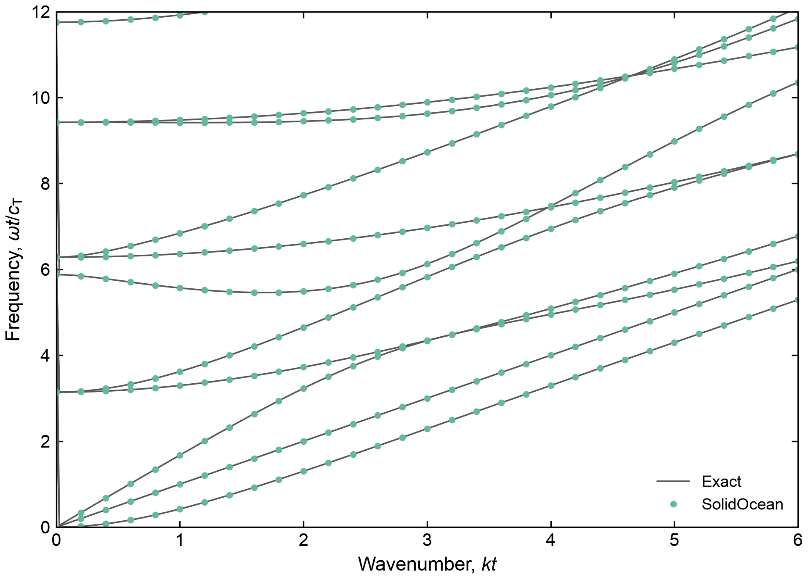<figcaption>
Guided modes of a free plate: exact Rayleigh-Lamb and SH branches (lines) and the computed eigenfrequencies (circles), mesh h = t/16.
</figcaption></figure>

<figure>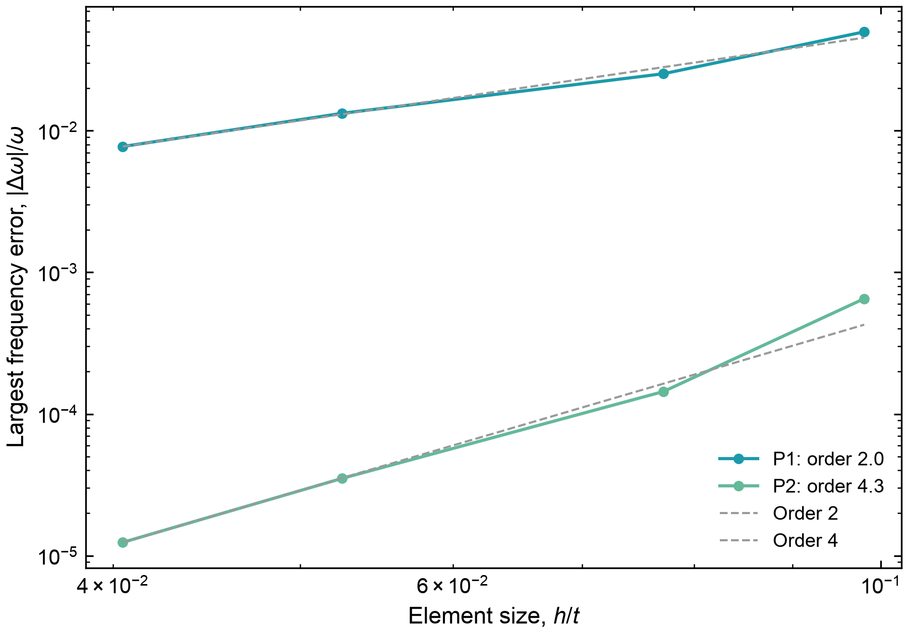<figcaption>
Mesh convergence of the eigenfrequencies at kt = 3 (largest error of all modes below ω t / c_T = 12); expected orders P1: 2, P2: 4.
</figcaption></figure>

**Checks:** ✅ largest frequency error along the path (h = t/16): 2.74e-04 (≤ 1.00e-03); ✅ P2 convergence order: 4.35 (≥ 3.50); ✅ P1 convergence order: 2.04 (≥ 1.80). Run time 65 s.

### Density of states of a membrane over the Brillouin zone

The same free plate as the Lamb case, but asked a different question: not where the branches lie, but how many states each frequency carries. An unpatterned membrane is given an artificial square cell of side $$ a = 0.4\,t $$, its bands are computed over a mesh of the irreducible wedge of that cell's Brillouin zone, and the spectra are summed from the wedge (physics/solid/spectra.py).

The reference needs no mesh. The plate is isotropic, so its exact dispersion is radially symmetric: every Rayleigh-Lamb and shear-horizontal branch $$ \omega_j(k) $$, rotated about the origin, is a surface whose iso-frequency contour is a circle of circumference $$ 2\pi k_j(\omega) $$. Summing those circles gives

$$
D(f) = \frac{1}{(2\pi)^2}\sum_j \frac{2\pi k_j}{|\mathrm{d}f/\mathrm{d}k|_j},\qquad \langle v\rangle(f) = 2\pi\frac{\sum_j k_j}{\sum_j k_j/|\mathrm{d}f/\mathrm{d}k|_j},
$$

evaluated on a dense grid of the exact branches. The two routes share nothing: one is a finite-element eigenproblem sampled over a two-dimensional zone of an invented cell, the other a one-dimensional analytic dispersion rotated in k-space. They must still agree, because the artificial cell only folds the states into its zone and folding moves no state. The comparison runs to $$ \omega t / c_\mathrm{T} = 10 $$, below which every computed band is present.

What is left over is the price of sampling. Bands are numbered by ascending frequency at each wavevector, so where two branches cross, the surfaces kink; a mesh of flat triangles cuts those corners and flattens the gradients. The density of states weights each contour by the gradient and feels this only weakly, while the group velocity and everything built on the contour length alone (the heat flux, the conductance) carry a systematic deficit. Both shrink as the wavevector mesh is refined, and both are the argument for sorting the surfaces into branches, which this release does not do. The last check is the quantity those spectra are for: the ballistic conductance at 0.1 K, with both routes integrated over the same window, so that what is compared is the sampling of the zone and not the states left above it.

<figure>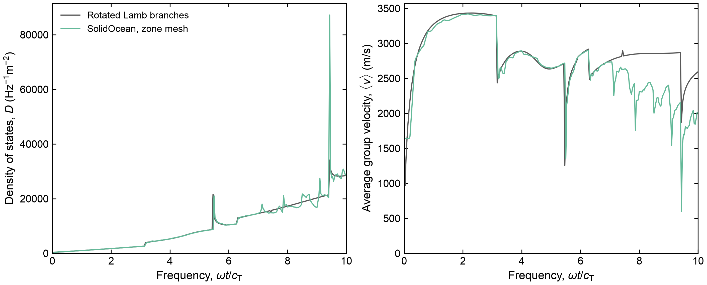<figcaption>
Spectra of an unpatterned plate from a mesh of the irreducible wedge (91 wavevectors, 16 bands) against the exact branches rotated about the origin. The density of states follows the reference including its van Hove steps; the group velocity sits low, where crossings of the unsorted surfaces flatten the gradients.
</figcaption></figure>

<figure>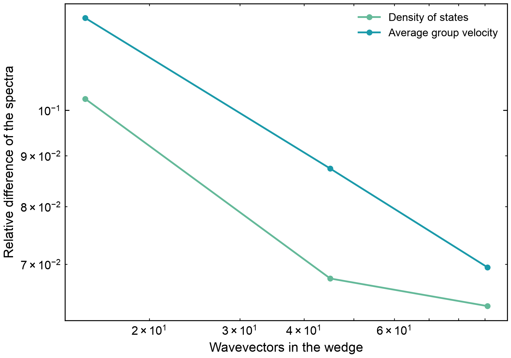<figcaption>
Both spectra approach the exact ones as the wavevector mesh is refined; the finite-element mesh is unchanged throughout, so what converges here is the sampling of the zone.
</figcaption></figure>

Wavevectors 15 / 45 / 91: the density of states differs from the exact one by 10.3 %, 6.8 %, 6.4 %, the group velocity by 12.4 %, 8.7 %, 7.0 %. Over the same window the states below it carry 4.04e-07 W/(K m) at 0.1 K, against 4.57e-07 W/(K m) exactly (-12 %).

**Checks:** ✅ ballistic conductance at 0.1 K: 1.16e-01 (≤ 1.50e-01); ✅ density of states, finest mesh: 6.35e-02 (≤ 8.00e-02); ✅ average group velocity, finest mesh: 6.95e-02 (≤ 1.20e-01); ✅ density of states improves with the mesh: 6.19e-01 (≤ 8.00e-01); ✅ group velocity improves with the mesh: 5.61e-01 (≤ 8.00e-01). Run time 75 s.

### Free vibrations of an elastic sphere

A free isotropic sphere (radius $$a$$, $$\nu = 0.25$$), meshed with curved quadratic elements. Reference: Lamb's exact solution. Torsional modes $${}_nT_l$$ satisfy $$x\,j_l'(x) = j_l(x)$$ with $$x = \omega a / c_T$$; spheroidal modes $${}_nS_l$$ follow from the traction-free surface ($$\sigma_{rr} = \sigma_{r\theta} = 0$$) for the displacement $$\mathbf{u} = \nabla\varphi + \nabla\times\nabla\times(\mathbf{r}\,\psi)$$ with $$\varphi = A\,j_l(\omega r/c_L)\,Y_{lm}$$, $$\psi = B\,j_l(\omega r / c_T)\,Y_{lm}$$ (a 2×2 determinant, solved to machine precision; the breathing mode is checked against Lamb's closed form $$\xi\cot\xi = 1 - \xi^2 c_L^2 / (4c_T^2)$$). Each mode of angular order $$l$$ is $$(2l+1)$$-fold degenerate. All computed eigenfrequencies up to $$\omega a / c_T = 4.6$$ (the six rigid-body modes removed) are compared with the exact spectrum, multiplicities included.

<figure>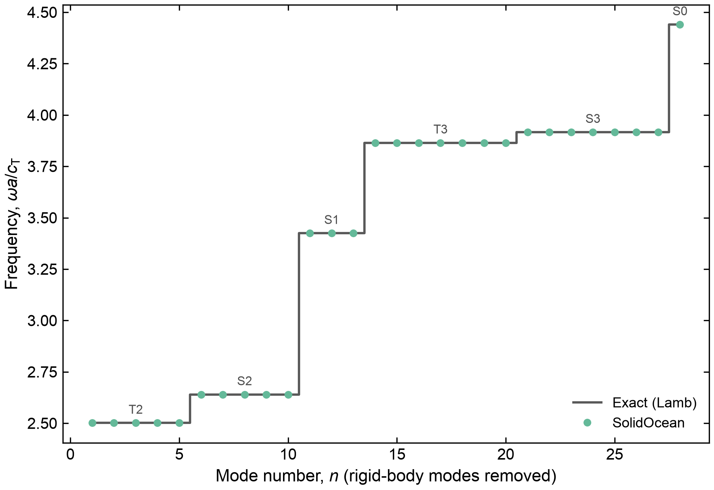<figcaption>
Spectrum of the free sphere: exact multiplets and the computed eigenfrequencies, mesh a/10.
</figcaption></figure>

<figure>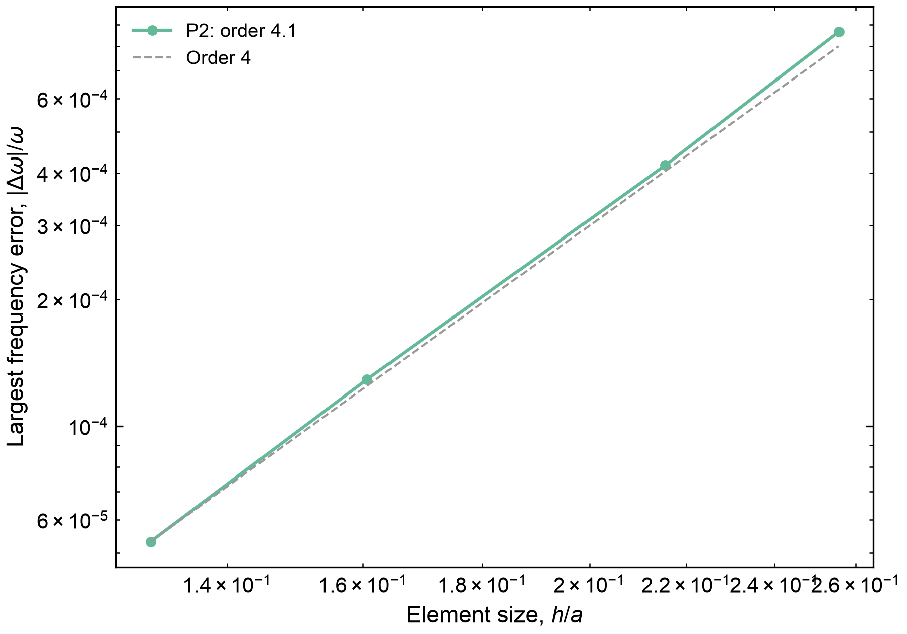<figcaption>
Mesh convergence of the sphere's eigenfrequencies (curved quadratic elements; expected order 4).
</figcaption></figure>

**Checks:** ✅ breathing mode: determinant vs closed form: 1.19e-13 (≤ 1.00e-12); ✅ largest frequency error (h = a/10): 5.32e-05 (≤ 1.00e-03); ✅ convergence order: 4.10 (≥ 3.30). Run time 24 s.

### Driven bar: resonances with losses

A bar of length $$L$$ in uniaxial strain (its side faces are symmetry planes, so compressional waves travel at $$c_L = \sqrt{C_{11}/\rho}$$ without dispersion), clamped at $$x = 0$$ and driven by a force amplitude $$F$$ on its end $$x = L$$, with a loss factor $$\eta$$ (complex stiffness $$C(1 + i\eta)$$). Reference: the exact harmonic response
$$
u(L) = \frac{F\,\tan(kL)}{C_{11}(1+i\eta)\,A\,k},\qquad k = \frac{\omega}{c_L\sqrt{1 + i\eta}},
$$
whose resonances (the bar's quarter-wave modes, $$f_n = (2n-1)\,c_L/4L$$) have the quality factor $$1/\eta$$. Frequency-domain problem swept across the first three resonances; quadratic elements.

<figure>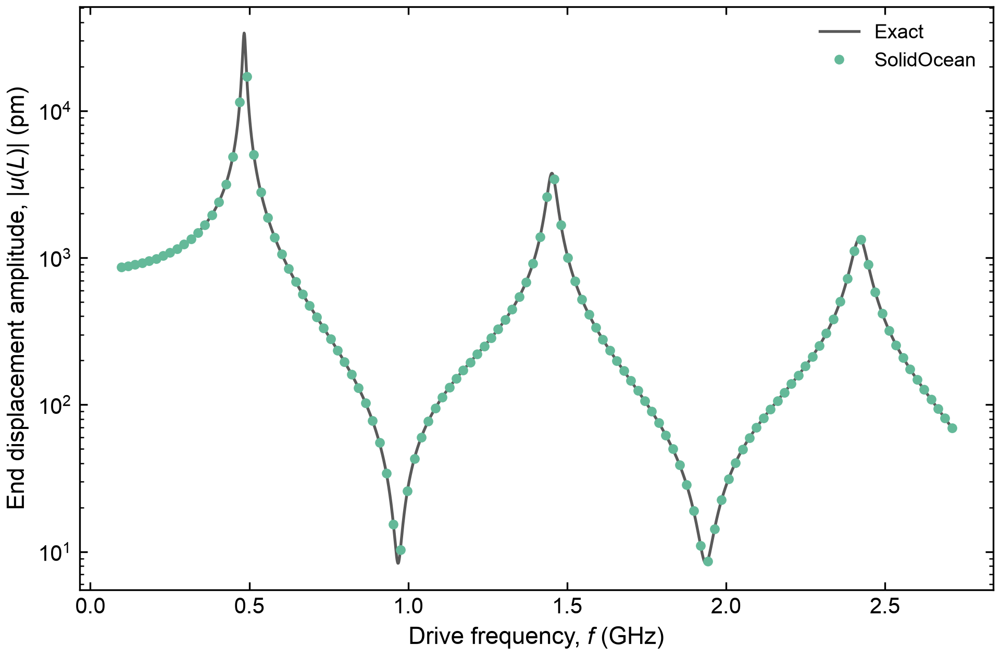<figcaption>
Resonance curve of the bar's end (loss factor η = 0.02): the first three quarter-wave resonances against the exact solution.
</figcaption></figure>

**Checks:** ✅ largest error relative to the peak amplitude: 5.04e-06 (≤ 1.00e-04). Run time 7 s.

## Statics

### Thick-walled cylinder under internal pressure

A tube (inner radius $$a$$, outer radius $$b = 2a$$, $$\nu = 0.3$$) under internal pressure $$p$$, in plane strain. A quarter of a slice is modelled: symmetry planes $$x = 0$$ and $$y = 0$$, and symmetry on both faces of the slice ($$u_z = 0$$, which is exactly plane strain). The pressure acts on the inner surface (a box selection). Reference: Lamé's solution
$$
\sigma_r = A - \frac{B}{r^2},\quad \sigma_\theta = A + \frac{B}{r^2},\quad \sigma_z = 2\nu A,\quad u_r = \frac{1+\nu}{E}\left[(1-2\nu)A\,r + \frac{B}{r}\right],\qquad A = \frac{p\,a^2}{b^2-a^2},\; B = \frac{p\,a^2 b^2}{b^2-a^2}.
$$
Errors are $$L^2$$ norms over the volume, relative to the norm of the exact field, integrated with the solver's quadrature. Expected orders: displacement $$h^{p+1}$$, stress $$h^p$$ for elements of degree $$p$$ (curved boundaries included, the quadratic elements being isoparametric).

<figure>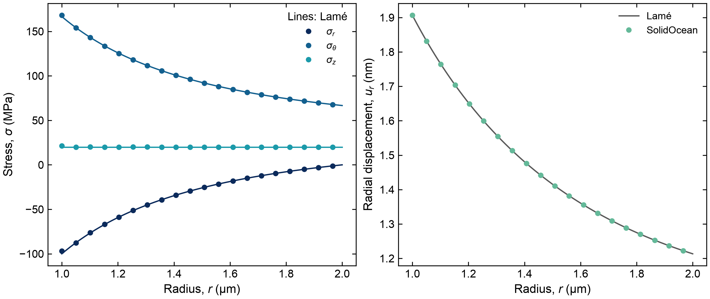<figcaption>
Stresses and radial displacement through the wall (along the 45° line, quadratic elements, finest mesh) against Lamé's solution.
</figcaption></figure>

<figure>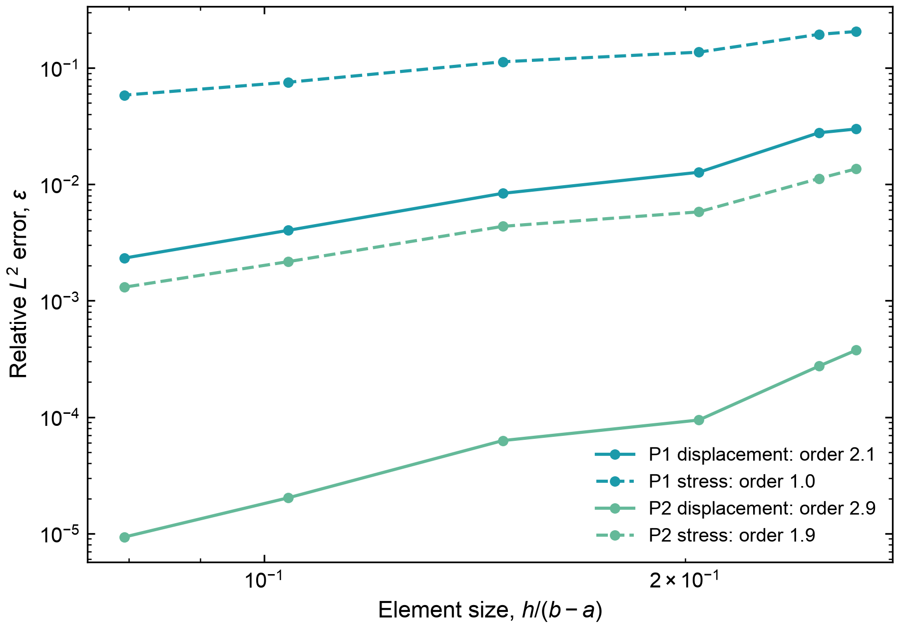<figcaption>
Mesh convergence of displacement and stress (expected orders: P1 2 and 1, P2 3 and 2).
</figcaption></figure>

**Checks:** ✅ P2 stress error (finest mesh): 1.31e-03 (≤ 2.00e-03); ✅ P2 displacement order: 2.92 (≥ 2.70); ✅ P2 stress order: 1.85 (≥ 1.80); ✅ P1 displacement order: 2.09 (≥ 1.80); ✅ P1 stress order: 1.03 (≥ 0.85). Run time 7 s.

## Heat transfer

### Semi-infinite solid heated by a surface flux

A constant heat flux $$q$$ switched on at $$t = 0$$ on the face $$x = 0$$ of a solid initially at $$T_0$$; the bar is long ($$L = 8\sqrt{\alpha t_\mathrm{end}}$$, far end held at $$T_0$$, insulated sides) so it behaves as a semi-infinite solid. Reference (Carslaw & Jaeger):
$$
T - T_0 = \frac{2q}{k}\sqrt{\frac{\alpha t}{\pi}}\,e^{-x^2/4\alpha t}
- \frac{q\,x}{k}\,\mathrm{erfc}\frac{x}{2\sqrt{\alpha t}},\qquad \alpha = \frac{k}{\rho c_p}.
$$
Errors are the largest nodal error at $$t_\mathrm{end}$$, relative to the surface temperature rise. The time convergence uses a fine mesh, the mesh convergence a fine time step. Backward Euler is first order. Crank-Nicolson is second order once the step resolves the start: the abrupt switch-on excites the stiff (fine-scale) modes, which Crank-Nicolson barely damps (its amplification factor tends to −1), so coarse steps leave a decaying oscillation; this is why backward Euler is the default for abrupt loads.

<figure>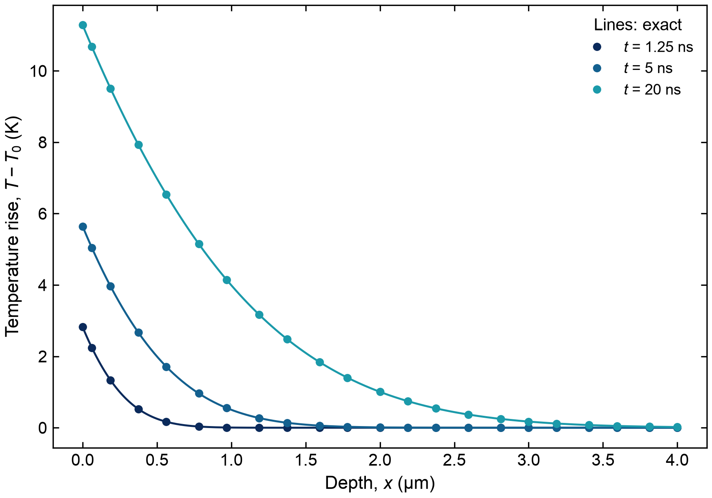<figcaption>
Temperature profiles at three times (Crank-Nicolson, 400 steps, quadratic elements) against the erfc solution.
</figcaption></figure>

**Checks:** ✅ profile error (CN, 400 steps): 5.13e-06 (≤ 1.00e-04); ✅ backward Euler order: 1.00 (≥ 0.95); ✅ Crank-Nicolson error (320 steps): 4.62e-06 (≤ 1.00e-04); ✅ P2 mesh order (largest nodal error): 3.41 (≥ 1.80). Run time 37 s.

### Disk heater on a half-space: spreading resistance

A uniform heat flux $$q = P / \pi a^2$$ into a disk of radius $$a$$ on the surface of a half-space (conductivity $$k$$), the rest of the surface insulated. Reference (Carslaw & Jaeger): the surface temperature
$$
\Delta T(r) = \frac{2qa}{\pi k}\,E\!\left(\tfrac{r}{a}\right)\ (r \le a),\qquad \Delta T(r) = \frac{2qa}{\pi k}\,\frac{r}{a}\left[E\!\left(\tfrac{a}{r}\right) - \left(1 - \tfrac{a^2}{r^2}\right) K\!\left(\tfrac{a}{r}\right)\right]\ (r > a),
$$
so the centre is at $$P/\pi k a$$ and the disk's mean temperature rise is $$8P/3\pi^2 k a$$ (spreading resistance $$8/3\pi^2 k a$$); $$E$$, $$K$$ are complete elliptic integrals. The model is a quarter of a hemisphere of radius $$R = 5a$$ (the symmetry planes are insulated faces) inside a shell of a very conductive material held at $$T_0$$: an isothermal sink sphere, which lowers the half-space solution by $$P/2\pi k R$$ (the next correction is of order $$(a/R)^5$$). The disk is a thin cylinder of the same material, so the mesh follows its edge. The step of the flux at the disk's edge makes the solution singular there (like $$\rho\ln\rho$$ at distance $$\rho$$ from the edge), which slows the convergence of the disk's mean temperature to about order 1.5; the centre converges much faster.

<figure>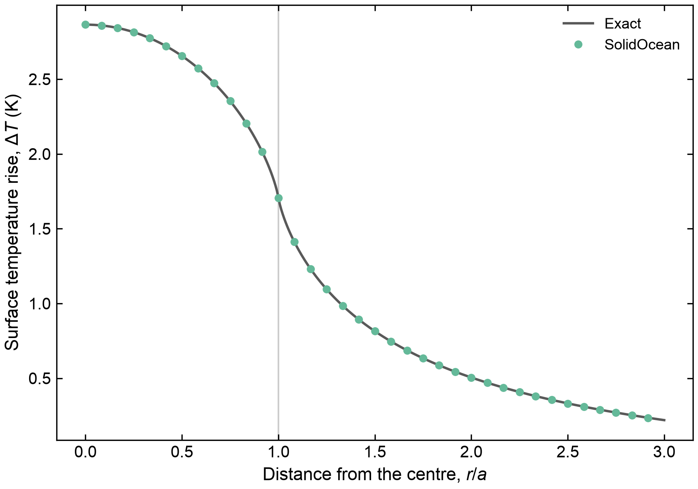<figcaption>
Surface temperature along a radius (mesh a/6) against the exact half-space solution (minus the sink's offset).
</figcaption></figure>

**Checks:** ✅ mean disk temperature (finest mesh): 8.42e-04 (≤ 1.00e-03); ✅ centre temperature (finest mesh): 8.17e-06 (≤ 1.00e-03); ✅ convergence order of the mean: 1.63 (≥ 1.50). Run time 15 s.

### Thermal boundary resistance in a layer stack

Layers along $$x$$ (insulated sides) joined by interfaces with a thermal boundary resistance: the temperature jumps by $$q R$$ across them.

*Steady state:* three layers between $$T_1$$ and $$T_0$$, joined by a contact resistance $$R_1$$ and by a thin layer
(thickness $$d$$, conductivity $$k_f$$, not meshed: $$R_2 = d / k_f$$). Reference: the series law $$q = (T_1 - T_0) / (\sum_i L_i/k_i + R_1 + R_2)$$, linear in each layer, which the elements represent exactly.

*Transient:* two layers (different conductivities and diffusivities) joined by a resistance $$R$$, initially at
$$T_0$$; at $$t = 0$$ the face $$x = 0$$ is raised to $$T_1$$. Reference: the eigenfunction series $$T = T_\mathrm{ss} + \sum_n c_n X_n(x)\,e^{-\lambda_n t}$$ with $$X_n = \sin(\beta_1 x)$$ in the first layer and $$B_n \sin(\beta_2 (L - x))$$ in the second ($$\beta_i = \sqrt{\lambda/\alpha_i}$$); the eigenvalues follow from flux continuity and the jump condition $$-k_1 X'(L_1) = (X_1 - X_2)/R$$:
$$
k_2\beta_2\cos\beta_2L_2\,\sin\beta_1L_1 + k_1\beta_1\cos\beta_1L_1\,\sin\beta_2L_2 + R\,k_1\beta_1k_2\beta_2\cos\beta_1L_1\cos\beta_2L_2 = 0,
$$
and the coefficients from the orthogonality of the $$X_n$$ with weight $$\rho c_p$$ (300 terms). The comparison starts at 5 ns: right after the step, the profile next to the hot face is steeper than the elements and the Crank-Nicolson start-up transient has not yet decayed (see the semi-infinite solid above).

<figure>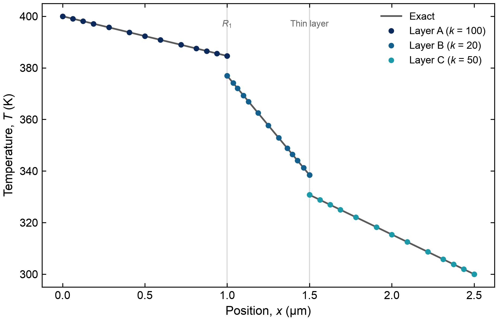<figcaption>
Steady temperature through the stack: jumps at the boundary resistance and at the thin layer, against the series law.
</figcaption></figure>

<figure>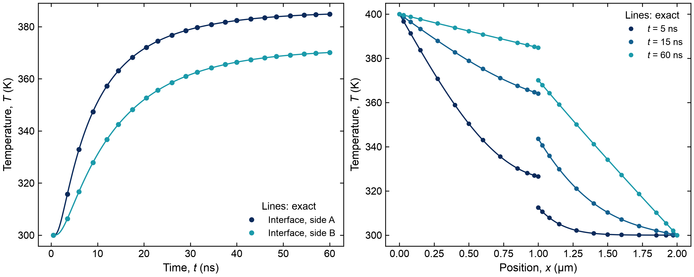<figcaption>
Two layers with a boundary resistance after the left face is raised to T₁: temperature on both sides of the interface against time, and profiles at three times (Crank-Nicolson, quadratic elements).
</figcaption></figure>

**Checks:** ✅ steady stack: flux and temperatures (P1 and P2): 1.70e-13 (≤ 1.00e-09); ✅ transient: largest nodal error for t ≥ 5 ns: 1.96e-04 (≤ 1.00e-03). Run time 2 s.

### 3ω heater line: frequency-domain heat transfer

A long heater strip of width $$2b$$ on a substrate (conductivity $$k$$, diffusivity $$\alpha$$) dissipates a power per length oscillating as $$P\,e^{i\omega t}$$ (in a 3ω measurement, the $$2\omega$$ part of the Joule heating). Reference: Cahill's exact average temperature oscillation of the strip on a semi-infinite substrate (Rev. Sci. Instrum. 61, 802 (1990)),
$$
\Delta \hat T(\omega) = \frac{P}{\pi k}\int_0^\infty \frac{\sin^2(\lambda b)}{(\lambda b)^2\sqrt{\lambda^2 + i\omega/\alpha}}\,d\lambda,
$$
whose in-phase part falls linearly with $$\ln\omega$$ (slope $$-P/2\pi k$$, from which 3ω measurements obtain $$k$$) while the out-of-phase part stays near $$-P/4k$$. The model is a slice of the substrate along the line (its two cut faces insulated: an infinite line), half of it by symmetry, with the heat flux on the strip (a thin block of the substrate's material under the surface, so the mesh follows the strip's edge) and the far faces held at the ambient temperature, more than five thermal penetration depths $$\sqrt{\alpha/\omega}$$ away at the lowest frequency. Frequency-domain problem, swept over the frequency; quadratic elements.

<figure>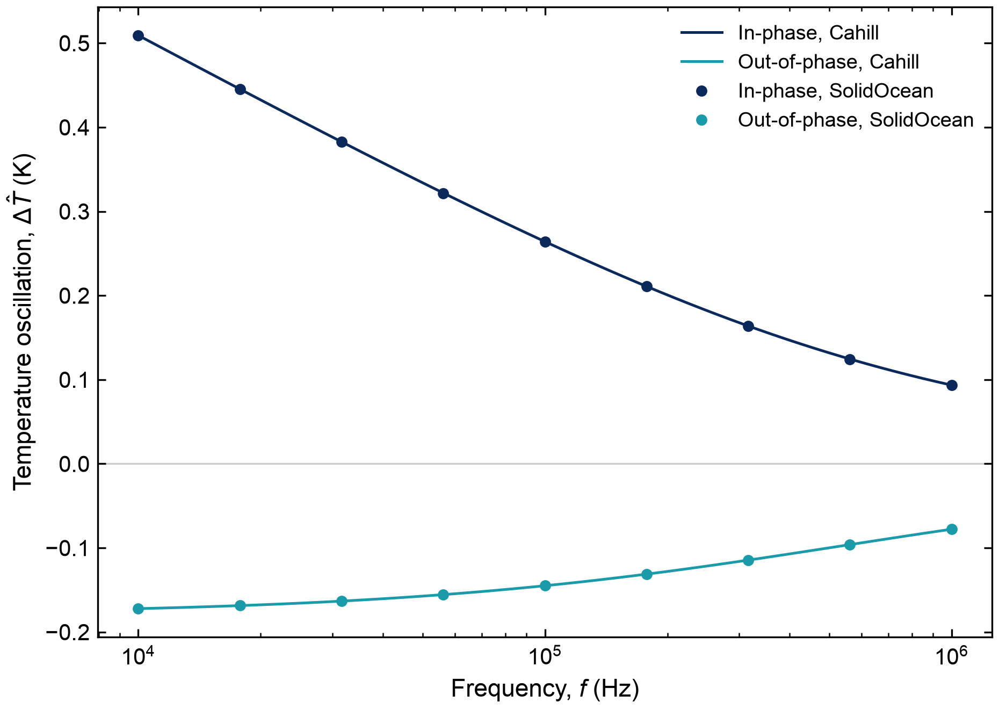<figcaption>
In-phase and out-of-phase temperature oscillation of the heater strip against Cahill's formula.
</figcaption></figure>

The 3ω slope method applied to the three lowest frequencies gives k = 1.448 W/(m·K) (true 1.4; Cahill's formula over the same points: 1.448).

**Checks:** ✅ amplitude error, every frequency: 1.18e-03 (≤ 1.00e-02); ✅ phase error (degrees), every frequency: 0.05 (≤ 0.50). Run time 25 s.

### FDTR: transducer film, boundary conductance and substrate

Frequency-domain thermoreflectance: a pump laser (Gaussian spot, FWHM $$w$$) modulated at $$f$$ heats a 100 nm gold transducer on silicon, with a thermal boundary conductance $$G$$ between them; a probe of the same size reads the film's temperature. Reference: the standard layered model of FDTR and TDTR (Cahill, Rev. Sci. Instrum. 75, 5119 (2004); Schmidt et al., ibid. 80, 094901 (2009)). In Hankel space the surface temperature is the heat flux times the impedance of the stack: $$Z = 1/(k_s q_s)$$ for the substrate, plus $$1/G$$ for the interface, carried through the film by
$$
Z \leftarrow \frac{Z + \tanh(q_f d)/(k_f q_f)}{1 + k_f q_f Z \tanh(q_f d)},\qquad q = \sqrt{\lambda^2 + i\omega/\alpha},
$$
and the probed temperature is $$\Delta T = \frac{P}{2\pi}\int_0^\infty \lambda Z(\lambda)\, e^{-\lambda^2(w_0^2 + w_1^2)/8}\,d\lambda$$ ($$w_0$$, $$w_1$$ the $$1/e^2$$ radii of pump and probe). The model is the template "FDTR: gold transducer on silicon" (a quarter of the spot, the boundary conductance as a contact resistance $$1/G$$, far faces at the ambient temperature); the probed temperature is the film's top surface temperature weighted by the probe's Gaussian. (The template's plots weight the film's volume instead, which reads about 1 % lower: the film's top is warmer than its average by about $$q d / 2k_f$$.)

<figure>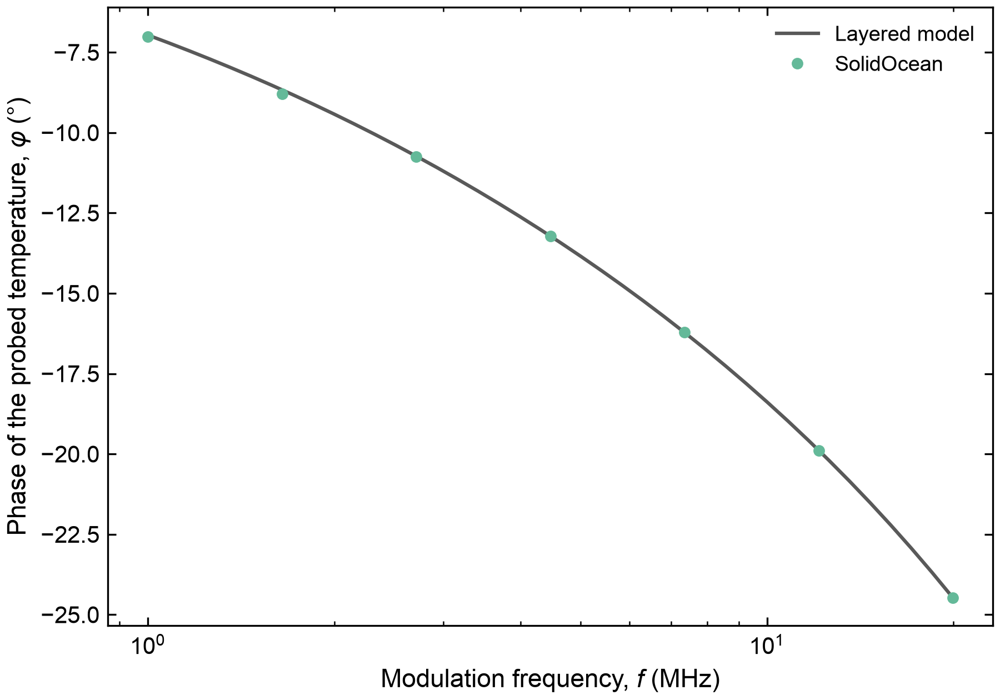<figcaption>
FDTR phase against frequency: the 3D model and the layered analytic model.
</figcaption></figure>

The difference at the lowest frequencies comes from the finite model: the far faces, held at the ambient temperature 10 µm away, are within a few thermal penetration depths (3.7 µm in Si at 1 MHz).

**Checks:** ✅ phase difference (degrees), every frequency: 0.12 (≤ 0.20); ✅ amplitude difference, every frequency: 5.73e-03 (≤ 1.00e-02). Run time 30 s.

---
*SolidOcean 0.1.3; generated 2026-10-15 on Darwin arm64, Python 3.13.16.*
